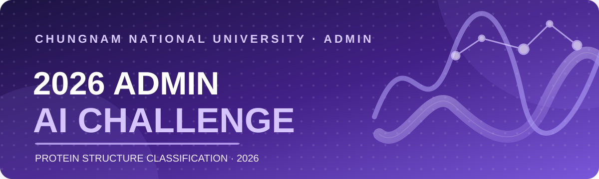

  

### 단백질의 구조를 읽고, AI로 가능성을 넓히다.

**2026 ADMIN AI Challenge**는 단백질 도메인의 서열·3차원 구조 정보를 활용해 **CATH Architecture를 분류하는 AI 모델링 대회**입니다.

충남대학교 소프트웨어중심대학사업단 · ADMIN

**[대회 소개](#-대회-소개)** · **[대회 결과](#-2026-대회-결과)** · **[전체 순위](#-최종-리더보드)** · **[프로젝트](#-프로젝트--자료)**

---

## 🧬 대회 소개

> **Predict the architecture. Understand the structure.**  
> 단백질의 아미노산 서열과 제공된 3D 구조(Cα 좌표)를 바탕으로 구조적 특징을 학습하고, 도메인을 **20개 CATH Architecture 클래스** 중 하나로 분류합니다.

| 항목 | 내용 |
| :--- | :--- |
| **대회명** | 2026 ADMIN AI Challenge — 단백질 구조 분류 대회 |
| **문제 유형** | 다중 클래스 분류 (20-class CATH Architecture) |
| **데이터** | CATH v4.4 S40 기반 단백질 도메인 서열 및 구조 |
| **데이터 규모** | 학습 **21,339개** · 평가 **5,330개** (총 **26,669개** 도메인) |
| **평가지표** | **Macro F1** — 20개 클래스의 F1을 동일한 비중으로 평균 |
| **평가 분할** | Public **30%** / Private **70%** |
| **최종 순위 기준** | 팀별 **최고 Public 점수 제출물**의 Private 점수 |
| **운영 방식** | 학습 모델·추론 코드 ZIP 제출, 격리된 평가 환경에서 채점 |
| **결과 발표** | 2026년 11월 1일 |

<b>대회의 주요 규칙 자세히 보기</b>

- 제공된 학습 데이터만 사용하며, 외부 데이터·외부 사전학습 가중치 사용은 금지됩니다.
- 팀당 대회 전체 **최대 20회** 제출할 수 있습니다.
- 모델과 `inference.py`, `train.py`, `requirements.txt`를 포함한 ZIP 파일을 제출합니다.
- 예측은 `id,label` 형식이며, **라벨별 F1을 평균한 Macro F1**으로 평가합니다.
- 최종 제출물은 Public 최고 점수를 기준으로 선정하고, 선정된 제출물의 Private 점수로 순위를 결정합니다. 동점 시 ZIP 크기, 이후 제출 시각 순으로 비교합니다.

## 🏆 2026 대회 결과

**2026 ADMIN AI Challenge — Final Leaderboard**

| 🥇 1위 | 🥈 2위 | 🥉 3위 (화면 표기) |
| :---: | :---: | :---: |
| **Team. 고고학과** | **멋진 깻잎** | **에이~아이에요~** |
| **0.6331** | **0.5900** | **0.5600** |
| Private Macro F1 | Private Macro F1 | Private Macro F1 |

### 🎖️ 시상 구성

| 구분 | 선정 규모 | 시상 |
| :--- | :---: | ---: |
| 최우수상 | 1팀 | 300,000원 |
| 우수상 | 1팀 | 200,000원 |
| 장려상 | 2팀 | 각 150,000원 |
| 효율성 특별상 | 1팀 | 팀원 수 × 2,000원권 커피 기프티콘 |
| 역전 특별상 | 1팀 | 올리브영 상품권 10,000원권 |
| 얼리버드 특별상 | 1팀 | 배달의민족 상품권 20,000원권 |

시상 구성은 결과 발표자료 기준입니다. 특별상 수상팀은 순위표만으로 확인되지 않으므로 별도 표기하지 않았습니다.

## 📊 최종 리더보드

**Private 점수 기반 최종 순위표 · 관리자 팀 제외**  
아래 순위와 점수는 제공된 **최종 리더보드 화면의 표시 내용**을 옮겼습니다.

| 순위 | 팀 | 제출 ID | Public | **Private** |
| :---: | :--- | :---: | ---: | ---: |
| 🥇 1 | **Team. 고고학과** | #149 | 0.6227 | **0.6331** |
| 🥈 2 | **멋진 깻잎** | #172 | 0.6396 | **0.5900** |
| 🥉 3 | **에이~아이에요~** | #159 | 0.6022 | **0.5600** |
| 4 | 해커톤인지도모르구여기에나wouldlikehatertoponeForthechuckwonder | #156 | 0.5823 | **0.5676** |
| 5 | 우리가이긴단백질 | #132 | 0.5809 | **0.5543** |
| 6 | 아랑해~ | #151 | 0.5694 | **0.5520** |
| 7 | 요들레이히~~~말고 엉크크 | #167 | 0.5639 | **0.5457** |
| 8 | 강준서헷어도괜찮아영? | #179 | 0.5532 | **0.5426** |
| 9 | 궁주민 | #155 | 0.5217 | **0.5304** |
| 10 | 26준비완료 | #114 | 0.4817 | **0.4597** |
| 11 | bAlo | #174 | 0.4903 | **0.4511** |

> **순위 검증 참고:** 제공된 이미지에서는 **3위의 Private 0.5600이 4위의 0.5676보다 낮아**, 안내된 점수순 정렬 규칙과 일치하지 않습니다. 위 표는 화면에 표시된 순서를 그대로 보존했습니다. 공식 확정 게시 전에 운영 원본과 확인이 필요합니다.

## 🛠️ 프로젝트 · 자료

이 Organization은 대회의 데이터 처리, 모델 평가, 제출 관리 및 리더보드 운영을 위한 개발 기록을 담고 있습니다.

| 프로젝트 | 소개 |
| :--- | :--- |
| [`admin-2026-protein-structure-challenge`](https://github.com/2026-admin-ai-challenge/admin-2026-protein-structure-challenge) | 참가자 웹사이트, 채점 API, 제출 대기열 및 리더보드 운영 |
| [`docs/competition.md`](https://github.com/2026-admin-ai-challenge/admin-2026-protein-structure-challenge/blob/main/docs/competition.md) | 참가자 안내·제출 형식·참가 규칙 문서 (운영 당시 내용) |
| [`docs/evaluation.md`](https://github.com/2026-admin-ai-challenge/admin-2026-protein-structure-challenge/blob/main/docs/evaluation.md) | Macro F1 채점 규칙과 Public / Private 순위 산정 방식 |

운영 전용 데이터와 정답, 참가자 계정 및 비밀번호는 공개 자료에 포함하지 않습니다.

---

### Thank you, challengers! 💜

모든 참가팀의 도전과 노력에 감사드립니다.  
**2026 ADMIN AI Challenge · November 1, 2026**

